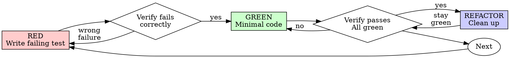

# Test-Driven Development (TDD)

## Overview

Write the test first. Watch it fail. Write minimal code to pass.

**Core principle:** If you didn't watch the test fail, you don't know if it tests the right thing.

**Violating the letter of the rules is violating the spirit of the rules.**

This skill is the concrete "how" behind `speckit-implement`'s rule: _"Every code change is
accompanied by a test"_ means RED → GREEN → REFACTOR, not tests-after. See
[ADR 0001](../../../docs/architecture/adr/0001-adopt-the-template-ruleset.md).

## When to Use

**Always**, for every task in `specs/NNN-slug/tasks.md` and every other production code change:

- New features
- Bug fixes
- Refactoring
- Behavior changes

**Exceptions (escalate to the human owner, same as any guardrail — AGENTS.md):**

- Throwaway prototypes / spikes the human owner marked as such
- Pure configuration files (`nx.json`, `.dependency-cruiser.cjs`)

Thinking "skip TDD just this once"? Stop. That's rationalization.

## The Iron Law

```
NO PRODUCTION CODE WITHOUT A FAILING TEST FIRST
```

Write code before the test? Delete it. Start over.

**No exceptions:**

- Don't keep it as "reference"
- Don't "adapt" it while writing tests
- Don't look at it
- Delete means delete

Implement fresh from tests. Period.

## Red-Green-Refactor



### RED - Write Failing Test

Write one minimal test showing what should happen, in the layer you're changing
(`domain`/`application`/`infrastructure` — never test through infrastructure what belongs
in domain).

<Good>
```typescript
test('retries failed operations 3 times', async () => {
  let attempts = 0;
  const operation = () => {
    attempts++;
    if (attempts < 3) throw new Error('fail');
    return 'success';
  };

const result = await retryOperation(operation);

expect(result).toBe('success');
expect(attempts).toBe(3);
});

````
Clear name, tests real behavior, one thing
</Good>

<Bad>
```typescript
test('retry works', async () => {
  const mock = jest.fn()
    .mockRejectedValueOnce(new Error())
    .mockRejectedValueOnce(new Error())
    .mockResolvedValueOnce('success');
  await retryOperation(mock);
  expect(mock).toHaveBeenCalledTimes(3);
});
````

Vague name, tests mock not code
</Bad>

**Requirements:**

- One behavior
- Clear name
- Real code (no mocks unless unavoidable — see the domain-layer purity rule in the
  constitution: domain tests should not need infrastructure mocks at all)

### Verify RED - Watch It Fail

**MANDATORY. Never skip.**

```bash
pnpm nx run <project>:test --testFile=path/to/file.spec.ts
```

Confirm:

- Test fails (not errors)
- Failure message is expected
- Fails because feature missing (not typos)

**Test passes?** You're testing existing behavior. Fix test.

**Test errors?** Fix error, re-run until it fails correctly.

### GREEN - Minimal Code

Write simplest code to pass the test.

<Good>
```typescript
async function retryOperation<T>(fn: () => Promise<T>): Promise<T> {
  for (let i = 0; i < 3; i++) {
    try {
      return await fn();
    } catch (e) {
      if (i === 2) throw e;
    }
  }
  throw new Error('unreachable');
}
```
Just enough to pass
</Good>

<Bad>
```typescript
async function retryOperation<T>(
  fn: () => Promise<T>,
  options?: {
    maxRetries?: number;
    backoff?: 'linear' | 'exponential';
    onRetry?: (attempt: number) => void;
  }
): Promise<T> {
  // YAGNI
}
```
Over-engineered
</Bad>

Don't add features, refactor other code, or "improve" beyond the test.

### Verify GREEN - Watch It Pass

**MANDATORY.**

```bash
pnpm nx run <project>:test
```

Confirm:

- Test passes
- Other tests still pass
- Output pristine (no errors, warnings)

**Test fails?** Fix code, not test.

**Other tests fail?** Fix now.

### REFACTOR - Clean Up

After green only:

- Remove duplication
- Improve names
- Extract helpers

Keep tests green. Don't add behavior. Then run `pnpm nx run <project>:build`,
`pnpm nx run <project>:test-typecheck` when the project owns tests, and
`pnpm nx run <project>:lint` before moving on — those are the next steps in
`speckit-implement`'s per-task loop.

### Repeat

Next failing test for next feature.

## Good Tests

| Quality          | Good                                | Bad                                                 |
| ---------------- | ----------------------------------- | --------------------------------------------------- |
| **Minimal**      | One thing. "and" in name? Split it. | `test('validates email and domain and whitespace')` |
| **Clear**        | Name describes behavior             | `test('test1')`                                     |
| **Shows intent** | Demonstrates desired API            | Obscures what code should do                        |

## Red Flags - STOP and Start Over

- Code before test, or test after implementation
- Test passes immediately / can't explain why it failed
- Rationalizing "just this once", "keep as reference", "already spent X hours"

**Tempted to skip, or need the fuller argument for a reviewer?** See
[`references/rationalizations-and-red-flags.md`](references/rationalizations-and-red-flags.md)
and [`references/why-order-matters.md`](references/why-order-matters.md) — the exhaustive
excuse/rebuttal tables, only needed when TDD is being questioned.

**Want a worked example?** See
[`references/example-bug-fix.md`](references/example-bug-fix.md) for a full RED→GREEN→REFACTOR
bug-fix walkthrough.

## Verification Checklist

Before marking a task done in `speckit-implement`:

- [ ] Every new function/method has a test
- [ ] Watched each test fail before implementing
- [ ] Each test failed for expected reason (feature missing, not typo)
- [ ] Wrote minimal code to pass each test
- [ ] All tests pass (`pnpm nx run <project>:test`)
- [ ] Output pristine (no errors, warnings)
- [ ] Tests use real code (mocks only if unavoidable)
- [ ] Edge cases and errors covered

Can't check all boxes? You skipped TDD. Start over.

## When Stuck

| Problem                | Solution                                                                                 |
| ---------------------- | ---------------------------------------------------------------------------------------- |
| Don't know how to test | Write wished-for API. Write assertion first. Ask your human partner.                     |
| Test too complicated   | Design too complicated. Simplify interface — check for a layer-boundary violation first. |
| Must mock everything   | Code too coupled. Use dependency injection.                                              |
| Test setup huge        | Extract helpers. Still complex? Simplify design.                                         |

## Debugging Integration

Bug found? Write failing test reproducing it. Follow TDD cycle. Test proves fix and
prevents regression.

Never fix bugs without a test.

## Final Rule

```
Production code → test exists and failed first
Otherwise → not TDD
```

No exceptions without your human partner's permission.
